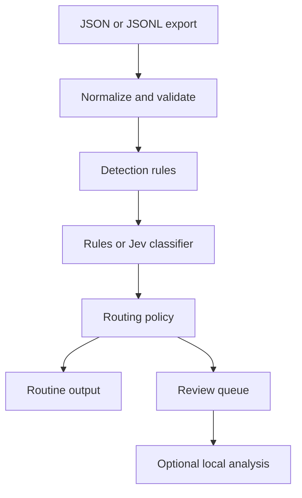

# JEV — SOC Alert Triage

Classify exported Windows security events, assign investigation priority, and
route uncertain or high-risk results into a review queue. TypeSafe's Jev is the
model backend; a separate rule baseline makes the pipeline runnable without
credentials. An optional Ollama stage produces structured investigation notes
for escalated events.

The useful output is the decision trail: event, detector hits, backend and model,
confidence, severity, routing reasons, and investigation status in one JSONL record.

## Run the demo

Python 3.11 or newer:

```bash
python -m venv .venv
source .venv/bin/activate
# Windows PowerShell: .venv\Scripts\Activate.ps1
python -m pip install -e '.[dev]'
jev-triage data/events.jsonl --backend rules --audit-rate 0 --output reports/triage.jsonl
python -m jev_triage.evaluation
pytest -q
```

The ten-event synthetic fixture covers encoded PowerShell, network retrieval,
LSASS access, task creation, PsExec, and benign controls. With audit sampling disabled, the rule baseline routes seven of ten records for
review under the default thresholds. Low confidence is intentionally conservative.
This small fixture is not a workload-reduction benchmark.
See [example decisions](examples/triage.jsonl) and the
[fixture evaluation](examples/evaluation.json).

## Use Jev

Create a TypeSafe API key and choose a model identifier supported by your account.
Credentials are environment variables; no `.env` file is automatically loaded.

```bash
export TYPESAFE_API_KEY='your-key'
export TYPESAFE_MODEL='your-account-model-id'
jev-triage data/events.jsonl --backend jev --output reports/jev.jsonl
python -m jev_triage.evaluation --results reports/jev.jsonl
```

PowerShell uses `$env:TYPESAFE_API_KEY = 'your-key'` and
`$env:TYPESAFE_MODEL = 'your-account-model-id'`.

The adapter uses the official SDK's `system_one` call with typed `Choice`
questions for classification and severity. Confidence comes from the selected
classification answer. Model severity uses a documented 20/50/80/100 scale;
detector severity is a floor. A suspicious lead alone does not establish maliciousness.
The offline backend always identifies itself as `rules`, never as Jev.

## Add deeper local analysis

Run Ollama locally with a model already downloaded, then pass its name:

```bash
jev-triage data/events.jsonl --backend jev --ollama-model YOUR_LOCAL_MODEL \
  --output reports/investigated.jsonl
```

The Ollama stage receives only the escalated record and its triage metadata. It
returns a summary, cited record IDs, hypotheses, and proposed next steps. The
schema and references are validated before the analysis is accepted. It does not
execute commands, gather further evidence, or change the triage decision.

## Routing policy

| Trigger | Default | Result |
|---|---:|---|
| Severity | ≥ 70/100 | Escalate |
| Classification confidence | < 0.75 | Escalate |
| Unknown or malicious label | Always | Escalate |
| Audit sampling of remaining records | 5% | Escalate when selected |
| Provider or response validation failure | Always | Escalate as unknown |

Audit sampling hashes the seed, host, and record ID into a reproducible uniform
selection. It is probabilistic sampling of routine alerts, not calibrated model
risk. `--audit-rate 0` disables it; `--audit-rate 1` reviews all otherwise routine
records. Use `--seed` to change the sample. Thresholds are CLI options.

Without an investigator, escalated events are marked `queued`. No investigation
is implied by queueing. Failed external calls are recorded by exception type,
without provider exception text that might expose credentials. Exit code 2 means
one or more classifications or investigations failed; the output is still saved.

## Design



[Architecture and tradeoffs](docs/design.md) explain confidence handling, data
boundaries, and the evaluation approach. [Event format](docs/events.md) includes
an export workflow. [Detection coverage](docs/detections.md) lists the exact rules.

## Validation and limits

`pytest` covers event normalization, invalid inputs, duplicate IDs, rule behavior,
routing, sampling, provider failure, the SDK adapter contract, and local-analysis
response validation. CI runs lint, formatting, and tests on Python 3.11–3.13.
The examples were produced with the offline backend. Live Jev and Ollama inference
require your credentials/runtime and have not been validated against a live model
in this release. No accuracy, speed, or cost claims are made for either model.

This is a snapshot triage project: no EDR connector, live ingestion, SIEM service,
probability calibration, or automatic containment. Validate on representative,
labeled telemetry before using decisions in an operational workflow.

## References

- [TypeSafe Python SDK](https://docs.typesafe.ai/sdk/python)
- [TypeSafe SDK source](https://github.com/typesafe-ai/typesafe-sdk-python)
- [Ollama chat API](https://docs.ollama.com/api/chat)
- [Microsoft Sysmon](https://learn.microsoft.com/en-us/sysinternals/downloads/sysmon)

MIT license.
